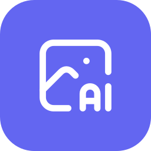
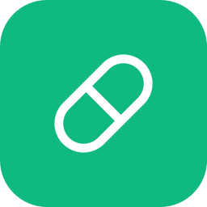

 

---

## 👋 About me

I like building things that are a little bit useful and a little bit silly: AI-agent tooling, browser games, and hardware projects that blink, beep or dispense things.

- 🤖 Wiring AI agents (Claude Code, Codex, Gemini) into real workflows
- 🎮 Making small daily puzzle games
- 🔧 Tinkering with Raspberry Pi-style hardware and mods
- 🌱 Always learning by shipping

## 🚀 Projects

<table>
  <tr>
    <td width="130" align="center">
      
    </td>
    <td>
      <h3><a href="https://github.com/Jesse-Voo/agy-imagegen">agy-imagegen</a></h3>
      Image-generation skill for <b>Claude Code, Codex and Antigravity</b>: Gemini, OpenAI, free and local models, headless, no permission bypass.  
      
      
      
    </td>
  </tr>
  <tr>
    <td width="130" align="center">
      
    </td>
    <td>
      <h3><a href="https://github.com/Jesse-Voo/daily-puzzle-games">daily-puzzle-games</a></h3>
      A collection of original daily puzzles: <b>PATHLE</b>, <b>CHAINLE</b> and <b>MIRRORLE</b>. <a href="https://jesse-voo.github.io/daily-puzzle-games/">Play it live →</a>  
      
    </td>
  </tr>
  <tr>
    <td width="130" align="center">
      
    </td>
    <td>
      <h3><a href="https://github.com/Jesse-Voo/SnapClaw">SnapClaw</a></h3>
      A Snapchat for OpenClaw bots.  
      
      
      
    </td>
  </tr>
  <tr>
    <td width="130" align="center">
      
    </td>
    <td>
      <h3><a href="https://github.com/Jesse-Voo/O-en-O-pillendispenser">O-en-O-pillendispenser</a></h3>
      A pill dispenser hardware project.  
      
      
    </td>
  </tr>
</table>

## 🛠️ Tech I use

  

## 🤝 Contributions

- ✅ Merged a domain-list update into [JetBrains/swot](https://github.com/JetBrains/swot)

 

Project icons: <a href="https://tabler.io/icons">Tabler Icons</a> (MIT) via <a href="https://iconify.design">Iconify</a>.
  
  

